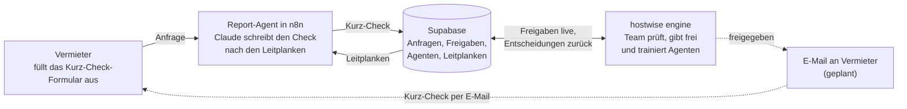
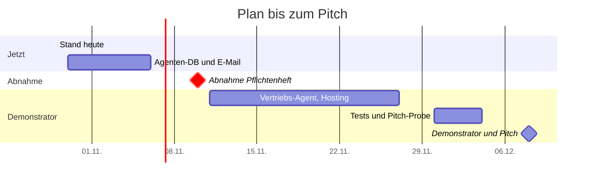

# hostwise engine – Pflichtenheft

> [!info] Lebende Fassung
> Diese Datei ist eine Kopie vom 30.10.2026. Bearbeitet wird das Pflichtenheft im Claude Doc: [hostwise engine – Pflichtenheft](https://claude.ai/artifact/MW2zD4FgRRXY9RGqj9ohLz). Dort gibt es auch die Auswahlfelder für Stand und Testergebnis.

Die hostwise engine ist das Gehirn von hostwise: ein Web-Dashboard, in dem unser Team alle KI-Agenten sieht, trainiert, anbindet und ihre Ergebnisse freigibt. Grundgerüst, Login, Datenbank und der erste echte Agent (Report-Agent) laufen bereits; dieses Pflichtenheft beschreibt, was gebaut ist und was bis zum Demonstrator dazukommt.

## Steckbrief

| | |
| --- | --- |
| Projekt | hostwise engine, Steuerzentrale für die KI-Agenten von hostwise |
| Geschäftsidee | Reports für Besitzer von Ferienunterkünften: Kurz-Check 0 €, Quick-Check 29 €, Komplett-Analyse 149 €, Monitor 39 €/Monat |
| Ziel | hostwise wird zu ca. 90 % von KI-Agenten betrieben, das Team prüft und gibt frei |
| Team | Lukas Bosser, Oskar Herkt, Maximilian Renner (HM München, Modul Entrepreneurship) |
| Abnahme Pflichtenheft | 10.11.2026 |
| Demonstrator und Pitch | 08.12.2026 |
| Code | [github.com/lukasbosser-cmyk/hostwisedemo](https://github.com/lukasbosser-cmyk/hostwisedemo) |
| Datenbank | Supabase-Projekt „hostwise“, Rechenzentrum Frankfurt |
| Agenten-Ablauf | n8n Cloud, [hostwise.app.n8n.cloud](https://hostwise.app.n8n.cloud) |

## 1 Zielbestimmung

Bis zum Demonstrator muss ein Vermieter einen Kurz-Check anfordern können, den ein Agent schreibt und ein Mensch in der engine freigibt. Alles andere baut auf diesem Ablauf auf.

### Musskriterien (Demonstrator)

| Nr. | Kriterium | Stand |
| --- | --- | --- |
| M1 | Nur unsere drei Admins kommen mit E-Mail und Passwort in die engine | umgesetzt |
| M2 | Das Cockpit zeigt Kennzahlen, alle Agenten im Engine-Kern, Live-Aktivität und offene Freigaben | in Arbeit |
| M3 | Status, Selbstständigkeit, Leitplanken und Wissensquellen jedes Agenten werden in der Datenbank gespeichert | umgesetzt |
| M4 | Jeder Report wartet auf eine menschliche Freigabe, bevor er rausgeht (Beta-Regel) | umgesetzt |
| M5 | Der Report-Agent macht aus dem Formular einen Kurz-Check und legt ihn zur Freigabe ab | umgesetzt |
| M6 | Der Report-Agent hält sich an die Leitplanken, die das Team in der engine pflegt | umgesetzt |
| M7 | Ein freigegebener Kurz-Check geht per E-Mail an den Vermieter | geplant |
| M8 | Neue Freigaben und Aktivitäten erscheinen ohne Neuladen | umgesetzt |
| M9 | Alle Texte auf Deutsch, in einfacher Sprache und im hostwise-CI | umgesetzt |

M2 ist in Arbeit, weil die Kennzahlen noch Beispielwerte sind.

### Wunschkriterien (nach dem Demonstrator)

| Nr. | Kriterium | Stand |
| --- | --- | --- |
| W1 | Vertriebs-Agent schaltet Meta-Ads; jede Budgetänderung über 20 % braucht eine Freigabe | geplant |
| W2 | Marktdaten-Agent liest Preise und Belegung von Airbnb und Booking.com sowie Großveranstaltungen über Firecrawl | umgesetzt |
| W3 | Quick-Check für 29 € mit Bezahlung | geplant |
| W4 | Agenten lernen aus den Bewertungen des Teams (gut oder schlecht) | geplant |
| W5 | Landingpage, sobald die Agenten stehen | geplant |

### Abgrenzung (bewusst nicht enthalten)

- Keine personenbezogenen Daten von Airbnb oder Booking.com: Wir lesen dort nur Marktdaten, keine Gastgebernamen, Personenfotos oder Bewertungstexte.
- Keine Logins für Vermieter: Sie nutzen nur das Formular und bekommen E-Mails.
- In der Beta schickt kein Agent etwas ohne Freigabe an Kunden.
- Keine eigene KI-Entwicklung: Wir nutzen Claude über n8n.
- Keine eigene Handy-App: Die engine läuft im Browser, auch auf dem Handy.

## 2 Produkteinsatz

Die engine ist ein internes Werkzeug für das hostwise-Team. Vermieter sehen sie nie: Sie kommen nur über das Formular und die E-Mail mit hostwise in Berührung.

| Rolle | Wer | Was sie tun |
| --- | --- | --- |
| Admin | Lukas, Oskar, Maximilian | Agenten einstellen und trainieren, Ergebnisse prüfen und freigeben, Wissen pflegen |
| Vermieter (Kunde) | Private Besitzer von Ferienwohnungen, Ferienhäusern und Zimmern, z. B. ein Bauernhof mit Ferienzimmern | Kurz-Check über das Formular anfordern, Ergebnis per E-Mail erhalten, später Quick-Check oder Komplett-Analyse kaufen |
| Agent | KI-Abläufe in n8n | Aufgaben abarbeiten und Ergebnisse zur Freigabe in die engine legen |

**Betriebsbedingungen**

- Läuft im Browser auf Laptop und Handy, ohne Installation.
- Wenige Admins, täglich im Einsatz; offene Freigaben sollen innerhalb von 24 Stunden erledigt sein, weil das Formular dem Vermieter das verspricht.
- Daten liegen in der EU (Supabase, Rechenzentrum Frankfurt); Hosting der engine später bei Netlify.
- Ohne Zugangsdaten startet die engine im Demo-Modus mit Beispieldaten, etwa für Präsentationen.

## 3 Produktübersicht

Der Kurz-Check ist der erste vollständige Ablauf und das Muster für alle weiteren Agenten: Ein Agent arbeitet in n8n, Supabase hält alles fest, und das Team entscheidet in der engine.

Der Agent liest seine Leitplanken bei jedem Durchlauf aus Supabase; die E-Mail an den Vermieter ist der letzte Baustein, der noch fehlt.

## 4 Produktfunktionen

Von 30 Funktionen sind 26 umgesetzt, 1 in Arbeit und 3 geplant. In Arbeit ist nur F20, weil die Kennzahlen im Cockpit noch Beispielwerte sind.

| Nr. | Bereich | Funktion | Stand |
| --- | --- | --- | --- |
| F10 | Zugang | Anmelden mit E-Mail und Passwort; wer nicht auf der Admin-Liste steht, wird abgemeldet | umgesetzt |
| F11 | Zugang | Abmelden über das Nutzer-Menü | umgesetzt |
| F20 | Cockpit | Kennzahlen: Reports der Woche, offene Freigaben, neue Leads, Werbebudget heute | in Arbeit |
| F21 | Cockpit | Engine-Kern: alle Agenten kreisen um das Logo, arbeitende Agenten schicken goldene Impulse ins Zentrum | umgesetzt |
| F22 | Cockpit | Live-Aktivität: was die Agenten gerade tun, ohne Neuladen | umgesetzt |
| F23 | Cockpit | „Wartet auf dich“: die nächsten offenen Freigaben | umgesetzt |
| F24 | Cockpit | Hinweis bei jeder neuen Freigabe, Zähler in der Seitenleiste | umgesetzt |
| F30 | Agenten | Übersicht aller Agenten mit Filter: alle, aktiv, im Training, pausiert, verfügbar | umgesetzt |
| F31 | Agenten | Agent pausieren und wieder starten | umgesetzt |
| F32 | Training | Selbstständigkeit wählen: nur vorschlagen, mit Freigabe, selbstständig | umgesetzt |
| F33 | Training | Leitplanken ein- und ausschalten, z. B. „Rechenweg offenlegen“ | umgesetzt |
| F34 | Training | Wissensquelle hinzufügen (Link, Dokument, Notiz) | umgesetzt |
| F35 | Agenten | Neuen Agenten in drei Schritten anbinden | umgesetzt |
| F36 | Training | Ergebnisse mit gut oder schlecht bewerten, damit der Agent daraus lernt | geplant |
| F40 | Freigaben | Liste aller offenen Ergebnisse mit Vorschau des Reports | umgesetzt |
| F41 | Freigaben | Freigeben oder zurückgeben; Name und Zeitpunkt werden gespeichert | umgesetzt |
| F42 | Freigaben | Jede Entscheidung erscheint als Aktivität im Cockpit | umgesetzt |
| F43 | Freigaben | Freigegebener Kurz-Check geht automatisch per E-Mail an den Vermieter | geplant |
| F50 | Wissen | Alle Wissensquellen aller Agenten an einem Ort | umgesetzt |
| F60 | Bedienung | Schnellsuche nach Seiten und Agenten mit Strg+K | umgesetzt |
| F70 | Report-Agent | Öffentliches Formular „Kurz-Check anfordern“ im hostwise-Design | umgesetzt |
| F71 | Report-Agent | Anfrage wird als Lead in der Datenbank gespeichert | umgesetzt |
| F72 | Report-Agent | Claude schreibt den Kurz-Check: Saisonpreise, Marktvergleich, höchstens drei Tipps | umgesetzt |
| F73 | Report-Agent | Der Agent liest seine Leitplanken aus der engine, bevor er schreibt | umgesetzt |
| F74 | Report-Agent | Kurz-Check landet als Freigabe in der engine und meldet sich im Live-Feed | umgesetzt |
| F75 | Report-Agent | Kurz-Check rechnet mit echten Marktdaten der Region: Preise je Saison, Vergleich mit gleich vielen Schlafzimmern, Großveranstaltungen | umgesetzt |
| F76 | Marktdaten-Agent | Liest pro Region und Saison ein Wochenende auf Airbnb und Booking.com, speichert Kennzahlen und anonyme Einzelangebote als Archiv; monatlich und auf Abruf des Report-Agenten | umgesetzt |
| F77 | Marktdaten | Seite „Marktdaten“: Preise je Saison und Portal, Großveranstaltungen, Ausstattung; Regionen aufnehmen und pausieren | umgesetzt |
| F78 | Daten | Seite „Daten“: alle Tabellen in Supabase ansehen und durchsuchen, erlaubte Felder ändern, Einträge mit Rückfrage löschen, als CSV herunterladen | umgesetzt |
| F80 | Einstellungen | Team, Benachrichtigungen und Zugänge verwalten | geplant |

> [!note] Stand 29.10.2026, abends
> F31 bis F35, F50 und F73 sind mit [Pull Request #2](https://github.com/lukasbosser-cmyk/hostwisedemo/pull/2) seit dem 29.10.2026 in der engine.

## 5 Produktdaten (Datenmodell)

Alle Daten liegen in acht Tabellen in Supabase; im Mittelpunkt steht die Tabelle `agents`, an der Verbindungen, Wissen, Leitplanken, Freigaben und Aktivitäten hängen. Felder mit „neu“ kommen mit Migration 0005 dazu.

| Tabelle | Was sie speichert | Wichtige Felder | Hängt an |
| --- | --- | --- | --- |
| `admins` | Wer in die engine darf | E-Mail, Name | – |
| `agents` | Alle Agenten | Name, Aufgabe, Symbol, Status (aktiv, training, pausiert, verfügbar), Selbstständigkeit (vorschlagen, freigabe, selbstständig), Trainingsstand 0–100; neu: Kennzahl, Verlauf, geändert am, geändert von | – |
| `agent_connections` | Dienste, die ein Agent nutzt, z. B. Meta Ads | Name, Status (verbunden, fehlt, fehler) | `agents` |
| `training_sources` | Wissen eines Agenten | Titel, Art (Dokument, Beispiel, Webseite, Daten), Link, angelegt am | `agents` |
| `guardrails` | Leitplanken eines Agenten | Text, an/aus; neu: Reihenfolge, angelegt am | `agents` |
| `leads` | Kurz-Check-Anfragen aus dem Formular, unverändert | Name, E-Mail, Ort, Art der Unterkunft, Preis pro Nacht, Inserat, Wunsch, Quelle | – |
| `approvals` | Ergebnisse, die auf Freigabe warten | Titel, Kunde, Zusammenfassung, Volltext, Grund, Wert, Stand (offen, freigegeben, zurückgegeben), entschieden von, entschieden am | `agents`, `leads` |
| `activity` | Live-Feed im Cockpit | Text, Zeitpunkt | `agents` |

**Zugriffsregeln**

- Jede Tabelle hat Row Level Security: Lesen und Schreiben darf nur, wer mit einer E-Mail aus `admins` angemeldet ist (Prüfung über `is_admin()`).
- n8n schreibt mit einem Server-Schlüssel, der nur in n8n hinterlegt ist. Im Code liegt nur der öffentliche Schlüssel.
- Live-Updates laufen über Supabase Realtime für `approvals` und `activity`, mit Migration 0005 auch für Agenten, Leitplanken, Wissen und Verbindungen.
- Jede neue Funktion bringt eine nummerierte Migration in `supabase/migrations/` mit, die auch auf das Projekt angewendet wird. Bisher: 0001 Grundschema, 0002 Startdaten, 0003 Anfragen, 0004 Live-Updates, 0005 Agenten-Einstellungen.

## 6 Agenten-Architektur

Jeder Agent ist ein fester Ablauf in n8n, der seine Einstellungen aus der engine holt und sein Ergebnis zurück in die engine legt. Die engine ist also die Steuerung, Supabase das gemeinsame Gedächtnis und n8n die Werkbank.

**Bauplan eines Agenten**

1. **Auslöser:** ein Formular, ein Zeitplan oder ein Ereignis, z. B. ein neuer Lead.
2. **Einstellungen holen:** Status, eingeschaltete Leitplanken und Wissen aus Supabase.
3. **Arbeiten:** Claude (Sonnet 5.5, über n8n) bekommt einen festen Auftrag plus die Leitplanken.
4. **Ergebnis ablegen:** als Freigabe in `approvals`, mit Kurzfassung und Volltext.
5. **Melden:** ein Eintrag in `activity`, das Cockpit zeigt ihn sofort.
6. **Mensch entscheidet:** freigeben oder zurückgeben, beides wird gespeichert.
7. **Handeln:** erst nach der Freigabe geht etwas nach außen, z. B. die E-Mail an den Vermieter.

**Selbstständigkeit** legt fest, wie weit ein Agent ohne Menschen gehen darf: „nur vorschlagen“, „mit Freigabe“ oder „selbstständig“. In der Beta gilt unabhängig davon: Jeder Report und jede Budgetänderung über 20 % braucht eine Freigabe.

**Leitplanken** sind kurze Regeln in Alltagssprache, die das Team in der engine an- und ausschaltet. Der Agent liest sie bei jedem Durchlauf neu, eine Änderung wirkt also ab der nächsten Anfrage, ohne dass jemand n8n öffnet.

| Agent | Aufgabe | Auslöser | Stand |
| --- | --- | --- | --- |
| Report | Kurz-Check aus der Formular-Anfrage schreiben, später Quick-Check und Komplett-Analyse | Formular | umgesetzt |
| Vertrieb | Meta-Ads schalten, Leads einschätzen, Rückrufe buchen | Zeitplan, neuer Lead | geplant |
| Marketing | Beiträge, Newsletter und Texte für die Landingpage entwerfen | Zeitplan | geplant |
| Marktdaten | Preise und Belegung von Airbnb und Booking.com sowie Großveranstaltungen sammeln, über Firecrawl | Zeitplan (1. jedes Monats), Auftrag vom Report-Agenten | umgesetzt |
| Analyse | Saisonpreise, Marktvergleich und hostwise-Score berechnen | Auftrag vom Report-Agenten | geplant |
| Support und Monitor | Fragen beantworten, Monitor-Kunden überwachen | E-Mail, Zeitplan | geplant |

Bewertungen, Fotos, Buchhaltung und Google Ads stehen als „verfügbar“ in der engine und lassen sich dort mit dem Assistenten anbinden, sobald ihr Ablauf in n8n steht.

## 7 Benutzeroberfläche

Die engine hat fünf Seiten plus Login; jede wichtige Handlung ist von der Startseite aus mit höchstens zwei Klicks erreichbar.

![[engine-cockpit.png]]

| Seite | Adresse | Was man dort tut |
| --- | --- | --- |
| Login | `/login` | Mit E-Mail und Passwort anmelden |
| Cockpit | `/` | Lage auf einen Blick: Kennzahlen, Engine-Kern, Live-Aktivität, „Wartet auf dich“ |
| Agenten | `/agenten` | Alle Agenten filtern, neue Agenten anbinden |
| Agent | `/agenten/[id]` | Reiter Überblick, Training, Verbindungen, Verlauf; pausieren, Selbstständigkeit, Leitplanken, Wissen |
| Freigaben | `/freigaben` | Ergebnisse lesen, freigeben oder zurückgeben |
| Marktdaten | `/marktdaten` | Preise je Saison und Portal, Großveranstaltungen und Ausstattung pro Region; Regionen aufnehmen und pausieren |
| Wissen | `/wissen` | Alle Wissensquellen an einem Ort |
| Daten | `/daten` | Alle Tabellen in Supabase ansehen, korrigieren, Testzeilen löschen, CSV herunterladen |
| Einstellungen | `/einstellungen` | Platzhalter für Team und Benachrichtigungen |

**Bedienprinzipien**

- Einfache Sprache ohne Fachbegriffe: „Freigeben“ statt „Approve“, „Leitplanke“ statt „Guardrail“.
- Jede Aktion gibt sofort Rückmeldung, etwa „Freigegeben“ unten am Rand.
- Was auf den Menschen wartet, steht immer oben: Zähler an „Freigaben“ und der Block „Wartet auf dich“.
- Schnellsuche mit Strg+K für Seiten und Agenten.
- Seitenleiste am Laptop, Leiste unten am Handy.

**Erscheinungsbild (hostwise-CI)**

- Farben: Tannengrün #10312B, Creme #F6F2EA, Gold #E1A23E nur als Akzent; Grün für „aktiv“, Rostrot für Fehler. Kein Blau und keine typische KI-Optik.
- Schriften: DM Serif Display für Überschriften, Inter für Text, DM Mono für Zahlen und kleine Überschriften.
- Animationen ruhig und weich: Agenten-Knoten erscheinen nacheinander, goldene Impulse laufen ins Zentrum, Karten heben sich beim Überfahren. Wer im Betriebssystem „Bewegung reduzieren“ eingestellt hat, bekommt nur sanfte Überblendungen.

## 8 Nichtfunktionale Anforderungen

Die wichtigste Anforderung ist Vertrauen: Kein Agent erreicht in der Beta einen Kunden ohne menschliche Freigabe, und nur unser Team sieht Kundendaten.

| Bereich | Anforderung | Wie wir sie erfüllen |
| --- | --- | --- |
| Sicherheit | Nur Admins sehen und ändern Daten | Login-Prüfung auf jeder Seite, Row Level Security auf jeder Tabelle, keine geheimen Schlüssel im Code, Passwörter nur im Supabase-Dashboard |
| Datenschutz | Kundendaten bleiben in der EU und nur so lange wie nötig | Supabase in Frankfurt; Datenschutzhinweis im Formular und Löschfrist für Leads sind noch offen (Abschnitt 11) |
| Recht | Rechtliche Risiken beim Auslesen klein halten | Von Airbnb und Booking.com nur Marktdaten, gespeichert werden Kennzahlen pro Region und Saison und nur anonyme Einzelangebote (Entscheidungen 29. und 30.10.2026); Schätzungen im Report sind als Schätzung gekennzeichnet |
| Qualität | Reports sind nachvollziehbar | Leitplanken erzwingen Saisonpreis-Tabelle, Marktvergleich und offenen Rechenweg; ein Mensch prüft jeden Report |
| Schnelligkeit | Vermieter bekommt den Kurz-Check innerhalb von 24 Stunden | Agent schreibt in wenigen Minuten, Freigabe-Zähler und Live-Hinweis halten die Warteschlange klein |
| Kosten | Grenzkosten pro Report ca. 1,50 € (Ziel aus dem Businessplan) | Gratis-Tarif bei Supabase, Claude über n8n-Guthaben, keine eigenen Server |
| Bedienbarkeit | Ohne Schulung nutzbar | Einfache Sprache, sofortige Rückmeldung, Strg+K, läuft auch am Handy |
| Barrierefreiheit | Lesbar und ruhig | Starke Kontraste im CI, Beschriftungen für Vorleseprogramme, reduzierte Bewegung wird respektiert |
| Ausfallsicherheit | Pitch klappt auch ohne Internet-Dienste | Demo-Modus mit Beispieldaten startet ohne Zugangsdaten |
| Wartbarkeit | Jeder im Team kann weiterbauen | Code auf GitHub, Build und Lint vor jedem Commit, Kontext für Claude Code in `CLAUDE.md`, Datenbankänderungen als Migration |

## 9 Technische Umgebung

Die engine besteht aus fünf fertigen Diensten, die wir nur verbinden; eigene Server betreiben wir nicht.

| Baustein | Wofür | Details |
| --- | --- | --- |
| Next.js 16 mit React, Tailwind und Motion | Oberfläche der engine | Eigene Komponenten, keine weiteren UI-Bibliotheken |
| Supabase | Datenbank, Login, Live-Updates | Projekt „hostwise“, Frankfurt, Gratis-Tarif |
| n8n Cloud | Abläufe der Agenten | Workflows „hostwise · Report-Agent (Kurz-Check)“ und „hostwise · Scraping-Agent (Marktdaten)“, Webseiten liest Firecrawl; Quelltext liegt im Repo unter `n8n/` |
| Claude Sonnet 5.5 | Texte und Analysen der Agenten | Über das KI-Guthaben von n8n |
| GitHub | Code und Änderungsvorschläge (Pull Requests) | Repo `hostwisedemo` |
| Netlify | Hosting der engine | Geplant für den Demonstrator |

**Entwicklungsablauf**

1. Änderung auf einem eigenen Branch bauen, bei neuen Daten mit Migration.
2. `npm run build` und `npm run lint` müssen fehlerfrei laufen.
3. Pull Request auf GitHub; jemand aus dem Team schaut drüber und führt ihn zusammen.
4. Lokal mit GitHub Desktop holen, `npm install`, `npm run dev`.

Claude Code liest dabei `CLAUDE.md` und hat über `.mcp.json` Zugriff auf Supabase (lesend), Context7 und Playwright.

## 10 Abnahmekriterien und Testfälle

Der Demonstrator ist abgenommen, wenn alle zwölf Tests bestanden sind; T7 bis T10 prüfen, was gerade noch entsteht.

| Nr. | So testen wir | Erwartetes Ergebnis | Prüft | Ergebnis |
| --- | --- | --- | --- | --- |
| T1 | Mit einer Admin-Adresse anmelden | Cockpit erscheint mit Namen in der Begrüßung | M1 | offen |
| T2 | Mit einer fremden Adresse anmelden | Zurück zum Login mit dem Hinweis „kein Zugang“ | M1 | offen |
| T3 | Ohne Login `/freigaben` aufrufen | Weiterleitung zum Login | M1 | offen |
| T4 | Kurz-Check-Formular ausfüllen | Wenige Minuten später: neue Freigabe, Hinweis, Zähler +1, der Report-Agent pulsiert im Engine-Kern | M5, M8 | offen |
| T5 | Den neuen Kurz-Check öffnen | Saisonpreis-Tabelle, Marktvergleich, höchstens drei Tipps, Prüf-Hinweis mit Rückruf-Angebot | M5 | offen |
| T6 | Kurz-Check freigeben | Verschwindet aus der Liste, Aktivität erscheint, in der Datenbank stehen Stand, Name und Zeit | M4 | offen |
| T7 | Eine Leitplanke für den Report-Agenten anlegen, dann T4 wiederholen | Der neue Kurz-Check hält sich an die neue Regel | M6 | offen |
| T8 | Agent pausieren und Seite neu laden; zweiter Admin hat die Seite offen | Agent bleibt pausiert; beim zweiten Admin ändert sich der Status ohne Neuladen | M3 | offen |
| T9 | Wissensquelle hinzufügen und Seite neu laden | Quelle steht beim Agenten und auf der Seite Wissen | M3 | offen |
| T10 | Kurz-Check aus T4 freigeben | Der Vermieter bekommt ihn per E-Mail | M7 | offen |
| T11 | Alle Seiten am Handy bedienen | Alles erreichbar, kein seitliches Scrollen | M9 | offen |
| T12 | engine ohne Zugangsdaten starten | Demo-Modus mit Beispieldaten, ohne Login | NFA | offen |

## 11 Zeitplan und offene Punkte

Bis zur Abnahme am 10.11. sollen die Agenten-Einstellungen in der Datenbank und der E-Mail-Versand stehen; danach folgen der Vertriebs-Agent und die Tests. Die Termine nach dem 10.11. sind ein Vorschlag.

Nach dem Pitch folgen laut Kursplan Business Model mit Go/No-Go am 12.01.2027 und die Abschlusspräsentation am 25.01.2027.

**Offene Punkte**

- [ ] Workflow „Report-Agent“ in n8n veröffentlichen, damit das Formular dauerhaft erreichbar ist
- [ ] Login-Konten für Oskar und Maximilian im Supabase-Dashboard anlegen
- [ ] E-Mail-Versand nach der Freigabe bauen (M7): Absender-Adresse und Versanddienst festlegen
- [ ] Datenschutzhinweis ins Formular aufnehmen und Löschfrist für Anfragen festlegen
- [ ] Klären, ob die Verarbeitung von Kundendaten über n8n und Claude einen Vertrag zur Auftragsverarbeitung braucht und wie riskant das Auslesen von Airbnb und Booking.com ist (AGB, Datenbankrecht)
- [ ] Kennzahlen im Cockpit aus echten Daten berechnen (M2)
- [ ] Zwei Test-Anfragen „Monika Testkundin“ aus `leads` löschen

Siehe auch: [[Entscheidungen]], [[Kursplan und Termine]], [[hostwise engine]].
